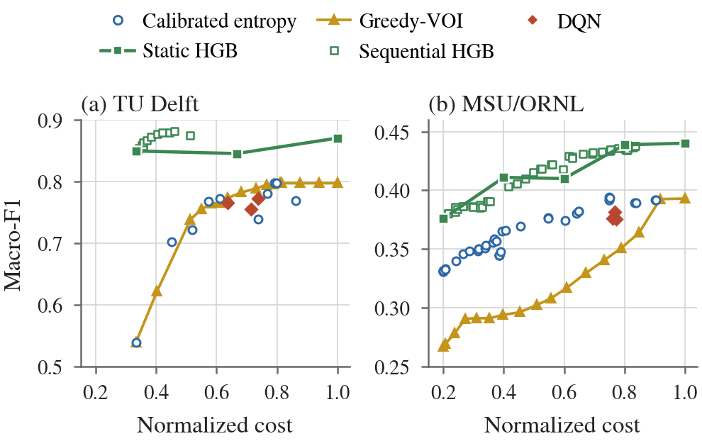

# ActiGrid

**When is learned evidence acquisition worth it for power system diagnosis?**

ActiGrid treats power-system fault-versus-attack diagnosis as a sequential decision. A mask-aware multimodal fusion classifier can classify from any subset of evidence sources. A Double-DQN policy decides which source to acquire next, or stops once the evidence is sufficient. The agent never controls grid equipment: it only chooses which diagnostic evidence to look at.

The paper asks when such a learned policy is worth its added complexity. It compares the DQN with every fixed subset and fixed acquisition order on one shared classifier, then retests on repeated group-disjoint splits against tree ensembles trained per subset, calibrated entropy stopping and a greedy value-of-information (Greedy-VOI) rule. The DQN does adapt to what it observes, but it shows no consistent advantage over entropy stopping, and compact subset classifiers outperform it at lower cost on both benchmarks. Over ten group-disjoint partitions, entropy stopping run over those subset classifiers beats the static subset at a common budget on every TU Delft partition, but on MSU/ORNL it does not beat it at any budget on average. Policy holdouts, a corrected MSU preprocessing check, a holdout Greedy-VOI rerun and corruption and normal-source mimicry tests are in the final audits. Selective acquisition can pay off, but on these benchmarks it does not need a learned policy.

This repository contains the code, the full result files, the run logs and the trained models behind the paper:

> *When Is Learned Evidence Acquisition Worth It for Power System Diagnosis?*, submitted to IEEE PES General Meeting 2027.

## Main results

**Shared backbone, ten training seeds on the primary group-disjoint split (paper Table I).** Every policy of a seed uses the same frozen fusion classifier.

| Dataset | Method | Macro-F1 | Normalized cost |
|---|---|---|---|
| TU Delft | Full fusion | **0.8158 ± 0.0323** | 1.000 |
| TU Delft | DQN (λ = 0.5) | 0.7917 ± 0.0333 | 0.703 |
| TU Delft | Order + entropy stopping | 0.7868 ± 0.0347 | 0.690 |
| TU Delft | Fixed subset, k = 2 | 0.6933 ± 0.0583 | 0.667 |
| MSU/ORNL | Full fusion | 0.3924 ± 0.0077 | 1.000 |
| MSU/ORNL | DQN (λ = 0.5) | 0.3769 ± 0.0118 | 0.754 |
| MSU/ORNL | Order + entropy stopping | 0.3859 ± 0.0131 | 0.787 |
| MSU/ORNL | Fixed subset, k = 2 | 0.3931 ± 0.0093 | 0.400 |
| MSU/ORNL | Fixed subset, k = 3 | **0.4011 ± 0.0101** | 0.600 |

**Repeated group-disjoint partitions (paper Table III).** The DQN rows use five partitions with one fixed model seed (4242). HGB rows are the histogram gradient boosting model selected on validation for each subset size k, over ten partitions. Every MSU/ORNL partition imputes missing values from its own training files.

| Dataset | Method | Partitions | Macro-F1 | Normalized cost |
|---|---|---|---|---|
| TU Delft | DQN | 5 | 0.7831 ± 0.0764 | 0.692 |
| TU Delft | Order + entropy stopping | 5 | 0.7944 ± 0.0652 | 0.701 |
| TU Delft | Full fusion | 5 | 0.8313 ± 0.0615 | 1.000 |
| TU Delft | HGB, k = 1 (network) | 10 | 0.8714 ± 0.0315 | 0.333 |
| TU Delft | HGB, k = 3 | 10 | **0.9001 ± 0.0496** | 1.000 |
| MSU/ORNL | DQN | 5 | 0.3674 ± 0.0098 | 0.744 |
| MSU/ORNL | Order + entropy stopping | 5 | 0.3754 ± 0.0141 | 0.759 |
| MSU/ORNL | Full fusion | 5 | 0.3881 ± 0.0079 | 1.000 |
| MSU/ORNL | HGB, k = 2 | 10 | 0.4185 ± 0.0123 | 0.400 |
| MSU/ORNL | HGB, k = 5 | 10 | **0.4356 ± 0.0133** | 1.000 |

**Static versus sequential HGB at common validation budgets, ten partitions (paper Table V).** Sequential HGB runs fixed-order entropy stopping over the per-subset HGB models. Temperatures are fitted on one half of the validation set; the order, the threshold and the static comparator are chosen on the other half. Wins count partitions where sequential HGB scores higher; p is an exact two-sided Wilcoxon signed-rank test over partitions, which share recordings and are therefore descriptive.

| Dataset | Budget | Static F1 | Sequential F1 | Difference | Wins | p | Sequential cost |
|---|---|---|---|---|---|---|---|
| TU Delft | 2/3 | 0.8482 | **0.9183** | +0.0701 | 10/10 | 0.002 | 0.523 |
| TU Delft | 1.0 | 0.8751 | **0.9183** | +0.0432 | 9/10 | 0.004 | 0.523 |
| MSU/ORNL | 0.4 | **0.4185** | 0.4015 | −0.0170 | 0/10 | 0.002 | 0.379 |
| MSU/ORNL | 0.6 | **0.4285** | 0.4171 | −0.0114 | 2/10 | 0.027 | 0.593 |
| MSU/ORNL | 1.0 | **0.4351** | 0.4332 | −0.0019 | 2/10 | 0.232 | 0.849 |

On the shared backbone the DQN keeps 97.0% of full-fusion Macro-F1 on TU Delft with 29.7% fewer modality units, but its paired difference from order + entropy stopping is only +0.005 (95% CI [−0.004, 0.014], Wilcoxon p = 0.43), and on MSU/ORNL a fixed three-source subset beats it. Over five partitions the DQN trails order + entropy stopping on both datasets (2/5 and 1/5 wins). With classifiers trained per subset, a single network-modality HGB on TU Delft and a two-relay HGB on MSU/ORNL score higher than every policy on the shared backbone at lower cost. Cost is the fraction of available modality units read (equal cost per modality), not bytes, latency or energy.

<p align="center"></p>

## Repository layout

```
actigrid/pipeline.py               Data loading, splits, fusion model, DQN, v7 protocol, evaluation
actigrid/controlled.py             Shared-backbone ten-seed experiment (paper Table I)
actigrid/hardening.py              Repeated splits, per-subset trees, lambda frontier, calibration,
                                   bootstrap, branching, corruption (paper Table VI, Figs. 2-4)
actigrid/greedy_voi.py             Greedy-VOI and calibrated entropy stopping on frozen backbones (Fig. 2)
actigrid/hgb_sequential.py         Earlier three-partition entropy stopping over per-subset HGB versus static HGB
actigrid/final_reviewer_clearance.py  Final audit: posterior shift, policy holdout DQN, MSU imputation/duplicates/
                                   random-row check, single-source models, corruption and mimicry (Tables II, IV, VII)
actigrid/four_issue_closure.py     Corrected rerun: ten HGB and five DQN partitions with training-only MSU
                                   imputation, static HGB corruption, Greedy-VOI on held-out rows
                                   (Tables III, V and VIII, tree curves of Fig. 2)
actigrid/reviewer_clearance.py     Fixed-subset and fixed-order entropy helpers and analyses
run_actigrid.py                    Command-line entry point (--stage controlled | hardening | greedy-voi |
                                   hgb-sequential | v7 | reviewer)
configs/paper_v7.json              Configuration used for the paper
scripts/verify_results.py          Recomputes every hardening/Greedy-VOI/sequential-HGB/closure summary
scripts/make_paper_tables.py       Prints the rows of paper Tables I-VIII and the statistics quoted with them
scripts/make_paper_figures.py      Rebuilds paper Figs. 2-4
scripts/make_method_diagram.py     Draws paper Fig. 1 (the acquisition loop)
scripts/extract_controlled_results.py  Parses the controlled-run log into CSV
scripts/msu_duplicate_audit.py     Counts exact MSU duplicates within and across files
results/controlled_same_backbone/  Ten-seed summary and paired effects (Table I)
results/reviewer_hardening/        Hardening outputs (Table VI, Figs. 2-4); cache/ holds its 12 fusion checkpoints
results/next_addon/                Greedy-VOI and calibrated entropy frontiers, Pareto points, AUCs
results/hgb_sequential/            Earlier three-partition static and sequential HGB run (superseded by four_issue_closure/)
results/final_reviewer_clearance/  Final audit outputs; cache/ holds the six policy holdout fusion/DQN checkpoints
results/four_issue_closure/        Corrected rerun outputs: per-partition and pooled HGB frontiers, matched budgets,
                                   corruption, five-partition DQN, Greedy-VOI holdout, seed plan
results/reviewer_clearance/        Per-seed exhaustive subsets, order+entropy search, budget curves
results/logs/                      Run logs (controlled, hardening, Greedy-VOI, sequential HGB, v7), TU Delft manifest
results/models/                    Seed-42 fusion classifier and DQN weights from the v7 run (PyTorch)
results/*_v7_selection.json        Frozen validation selections (lambda, DQN validation cost)
results/*.csv                      Earlier v7 protocol outputs (classical baselines, audits)
figures/                           Generated figures
```

## Installation

Python 3.10 or newer is required. The paper results were produced with Python 3.13, PyTorch 2.11, NumPy 2.1, pandas 2.3 and scikit-learn on Kaggle. The controlled and hardening runs used CPU; the v7 run and the Greedy-VOI inference used a Tesla T4 GPU. The sequential-HGB stage trains only tree models, which run on CPU.

```bash
git clone https://github.com/sazidul0/ActiGrid.git
cd ActiGrid
pip install -r requirements.txt
```

The code runs on CPU; a GPU only speeds up the neural parts.

## Data

Neither dataset is redistributed here. Download both from their original sources.

**MSU/ORNL power-system attack dataset.** This is the multiclass release with 15 `dataN Sampled Scenarios.csv.arff` files. It is available from the [UAH ICS data sets page](https://www.sites.google.com/a/uah.edu/tommy-morris-uah/ics-data-sets). Please cite Pan *et al.*, IEEE TII 2015.

**TU Delft cyber–physical digital-substation dataset.** This dataset is described in N. Cibin *et al.*, "Cyber–physical power system dataset for cyber security of digital substations," *IEEE Access*, vol. 14, 2026, [doi:10.1109/ACCESS.2026.3699153](https://doi.org/10.1109/ACCESS.2026.3699153). Follow the data-availability statement in that paper. Extract the archive before running; the pipeline can call `7z`/`unrar` if it finds only an archive.

A suggested layout:

```
data/
  msu_ornl/        data1 Sampled Scenarios.csv.arff ... data15 Sampled Scenarios.csv.arff
  tudelft_cpps/    2026_03_17_CPPS_Dataset_CyberSec_DigitalSubstation_TUD/...
```

## Reproducing the paper

All commands run from the repository root. The data options are the same for every stage:

```bash
DATA="--config configs/paper_v7.json --msu-root data/msu_ornl --tudelft-root data/tudelft_cpps --work-dir outputs"
```

**1. Rebuild the tables and figures from the released results.** This needs no data and no GPU (only `numpy` and `matplotlib`):

```bash
python scripts/verify_results.py      # recomputes every derived hardening/Greedy-VOI/sequential-HGB/closure file
python scripts/make_paper_tables.py   # paper Tables I-VIII as LaTeX rows, with win counts and Wilcoxon p-values
python scripts/make_paper_figures.py  # figures/fig_frontier, fig_calibration, fig_branching (Figs. 2-4)
python scripts/make_method_diagram.py # figures/fig_method (Fig. 1)
```

**2. Shared-backbone experiment (Table I).** For each dataset and each of ten seeds, this trains one fusion backbone and evaluates full fusion, all fixed subsets, all fixed orders with entropy stopping and the DQN on it. The frozen selections (λ = 0.5 and the DQN validation costs) are read from `results/*_v7_selection.json`. The paper run took about 7 hours on CPU; its log is [`results/logs/controlled_same_backbone.log`](results/logs/controlled_same_backbone.log).

```bash
python run_actigrid.py --stage controlled $DATA
```

**3. Hardening suite (Table VI, neural curves of Fig. 2, Figs. 3-4).** For each dataset this fits RF, HGB and XGBoost on every modality subset of three group-disjoint partitions (partition seeds 42, 123, 456), trains three fusion backbones on the primary split (initialization seeds 42, 123, 456) with a DQN for λ = 0.25, 0.5 and 0.75 plus two reward ablations each, runs the seed-42 calibration, bootstrap, branching and corruption analyses, and repeats the DQN versus order + entropy comparison on the three partitions. Every step writes a checkpoint, so an interrupted run resumes where it stopped; `--force` recomputes. The paper run (`--profile conference`, the default) spans about 12 hours of log time on CPU; its log is [`results/logs/reviewer_hardening.log`](results/logs/reviewer_hardening.log). `--profile full` adds splits, seeds, λ values, MLP subsets and a Dueling DDQN; the paper does not use it.

```bash
python run_actigrid.py --stage hardening $DATA
```

Outputs go to `outputs/reviewer_hardening/`; the released copy is [`results/reviewer_hardening/`](results/reviewer_hardening/).

**4. Greedy-VOI and calibrated entropy stopping (Fig. 2).** This reuses the hardening backbones (initialization seeds 42, 123, 456) without retraining any fusion, DQN or tree model. It fits one small HGB regressor per modality for Greedy-VOI, temperature-scales every mask, and evaluates all fixed orders and thresholds. To reproduce the paper's frontier exactly, point it at the released checkpoints:

```bash
python run_actigrid.py --stage greedy-voi $DATA --hardening-dir results/reviewer_hardening
```

Without `--hardening-dir` it uses `outputs/reviewer_hardening/` if step 3 has run there, otherwise the released folder. `--summaries-only` rebuilds the Pareto, AUC and calibration summaries from frontier CSVs already in `outputs/next_addon/`. The log of the paper run is [`results/logs/greedy_voi.log`](results/logs/greedy_voi.log).

**5. Sequential versus static HGB, earlier three-partition run.** Step 7 supersedes this stage for the paper. For each dataset and partition seed this trains one HGB model per nonempty modality subset (the hardening stage's settings), fits one temperature per subset on half of the validation set, and evaluates every fixed order with entropy stopping on raw and calibrated posteriors. The order, the threshold and the static comparator are chosen on the other validation half; the test set is only scored. It trains no neural model and checks its static scores against the hardening frontier. The log of the paper run is [`results/logs/hgb_sequential.log`](results/logs/hgb_sequential.log).

```bash
python run_actigrid.py --stage hgb-sequential $DATA
```

**6. Final reviewer-clearance audit (Tables II, IV and VII, supplement).** A standalone script that reuses the hardening outputs and adds the checks requested in review. It measures train-versus-validation posterior entropy and confidence on every mask, and trains a policy holdout control (fusion backbone on about 70% of training data, DQN on the rest: six versus three files on MSU/ORNL, a stratified row holdout within the 47 TU Delft runs). It also rebuilds MSU/ORNL with training-only median imputation, counts NaN/Inf and cross-file duplicates, and adds an 80/20 random-row HGB sanity split with confusion matrices. Further outputs are single-source neural versus HGB scores, and controlled corruption and normal-source mimicry of the frozen holdout DQN, raw entropy stopping and full fusion on attack samples. It is configured through environment variables (`ACTIGRID_MSU_ROOT`, `ACTIGRID_TU_ROOT`, `ACTIGRID_HARDEN_DIR` pointing at the hardening outputs, `ACTIGRID_WORK_DIR`) and ran on a Kaggle Tesla T4 in about 3 hours; its log is [`results/logs/final_reviewer_clearance.log`](results/logs/final_reviewer_clearance.log).

```bash
ACTIGRID_MSU_ROOT=data/msu_ornl ACTIGRID_TU_ROOT=data/tudelft_cpps \
ACTIGRID_HARDEN_DIR=results/reviewer_hardening ACTIGRID_WORK_DIR=outputs \
python actigrid/final_reviewer_clearance.py
python scripts/msu_duplicate_audit.py outputs/final_reviewer_clearance/cache/msu_raw_no_impute.joblib
```

Outputs go to `outputs/final_reviewer_clearance/`; the released copy is [`results/final_reviewer_clearance/`](results/final_reviewer_clearance/), with a readable summary in `FINAL_REVIEWER_CLEARANCE.md`. The second command counts duplicates inside files as well, which the audit itself does not: of 78,377 MSU/ORNL rows, 78,368 are unique. One fault or maintenance sample occurs nine times within the training file data8, and one remote-trip sample occurs in data8 (training) and data7 (validation). No duplicate has conflicting labels or reaches test.

**7. Corrected rerun (Tables III, V and VIII, Greedy-VOI holdout, tree curves of Fig. 2).** `actigrid/four_issue_closure.py` is a standalone script that closes four open items of the earlier run:

- It rebuilds the full static and sequential HGB frontier with MSU/ORNL median imputation fitted on each partition's training files, and with HGB early stopping disabled, so no internal random 10% holdout is used.
- It picks ten unique group-disjoint partitions per dataset from a fixed seed list, skipping seeds that reproduce an earlier partition (`*_split_seed_selection.csv`, `MULTISESSION_SEEDS.json`). HGB uses all ten, and the shared-backbone DQN comparison uses the first five with model seed 4242 and λ = 0.5.
- It corrupts the validation-selected static and sequential HGB models with training-mean replacement, Gaussian noise at two training standard deviations (both on every test row) and normal-class mimicry (attack rows only).
- It refits Greedy-VOI on training rows excluded from backbone fitting. MSU/ORNL separates whole files, while TU Delft falls back to stratified rows because its rare classes occur in too few training runs.

No test label selects a subset, order, threshold or temperature. The script carries a compressed copy of the base pipeline and does not import `actigrid.pipeline`. It writes a checkpoint after every partition, so an interrupted run resumes; the paper run spanned several Kaggle sessions.

```bash
ACTIGRID_MSU_ROOT=data/msu_ornl ACTIGRID_TU_ROOT=data/tudelft_cpps \
ACTIGRID_WORK_DIR=outputs ACTIGRID_ZIP_DIR=outputs \
python actigrid/four_issue_closure.py
```

Outputs go to `outputs/four_issue_closure/`; the released copy is [`results/four_issue_closure/`](results/four_issue_closure/), with a summary in `FOUR_ISSUE_CLOSURE_SUMMARY.md`. To resume in a new session, point `ACTIGRID_CHECKPOINT_ZIP` at the last `actigrid_four_issue_checkpoint.zip`.

**8. Optional earlier stages.** `--stage v7` re-runs the λ sweep and the earlier ten-seed v7 evaluation that produced the frozen selections. `--stage reviewer` re-runs the fixed-subset and order + entropy analyses on their own (results in `results/reviewer_clearance/`). Neither is needed for the paper's tables.

**9. Quick smoke test.** `--quick` uses few epochs and episodes, one split and seed for the hardening stage, and seed 42 only for Greedy-VOI and sequential HGB. The numbers are not meaningful; it only checks that a stage runs:

```bash
python run_actigrid.py --stage hardening --quick --datasets tudelft --config configs/paper_v7.json \
    --tudelft-root data/tudelft_cpps --work-dir outputs_smoke
python run_actigrid.py --stage greedy-voi --quick --datasets tudelft --config configs/paper_v7.json \
    --tudelft-root data/tudelft_cpps --work-dir outputs_smoke
python run_actigrid.py --stage hgb-sequential --quick --datasets tudelft --config configs/paper_v7.json \
    --tudelft-root data/tudelft_cpps --work-dir outputs_smoke
```

Other useful options are `--datasets msu tudelft`, `--seeds 42 123` (controlled stage), `--device cpu` and `--data-root data` (which auto-discovers the dataset folders).

## Protocol summary

- **Splits.** MSU/ORNL is split by source file (9/3/3 files; 47,471/15,272/15,634 samples) and TU Delft by recording run (47/16/16 runs; 3,246/1,276/1,316 one-second windows), so no file or run appears in two splits. All classes occur in every split. This primary split is `group_split(seed=42)`. The hardening and earlier sequential-HGB stages build three partitions with partition seeds 42, 123 and 456, and the corrected rerun builds ten; partition 42 reproduces the primary split exactly. The test windows of MSU/ORNL therefore come from files never seen in training, and no model trained under this protocol reaches 0.46 Macro-F1.
- **Modalities and cost.** MSU/ORNL has four PMU/relay groups plus cyber logs (cost 0.2 each). TU Delft has physical RSCAD measurements, resource-monitoring features and PCAP network features (cost 1/3 each).
- **Shared backbone.** For each dataset and seed, one fusion classifier is trained with modality dropout, then frozen and shared by every policy evaluated on that seed.
- **Policy.** A Double DQN with class-balanced episodes (20,000 per run). Its reward is a clipped log-probability gain for the true class minus λ × cost, with ±2 at termination and an extra −1 for confusing a fault with an attack. The true label is used only for the training reward; it is never part of the policy state. λ = 0.5 was selected on validation data in the v7 sweep and frozen.
- **Baselines.** Full fusion; every nonempty fixed subset, with the best subset of each size selected on validation Macro-F1; all M! fixed orders with entropy stopping, selected on validation within ±0.02 of the DQN's validation cost; RF, HGB and XGBoost trained per subset and selected on validation; calibrated entropy stopping (one temperature per mask fitted on half of the validation set, settings chosen on the other half); Greedy-VOI (acquire the source with the largest predicted entropy reduction per unit cost, fitted in-sample on 3,246 TU Delft and 7,000 MSU/ORNL training rows, then refitted on held-out rows in the corrected rerun); and sequential HGB (entropy stopping over the per-subset HGB models, compared with static HGB at matched validation budgets).
- **Three meanings of "seed 42".** The controlled run's seed 42 is one of its ten training seeds. *Initialization seed* 42 is one of three hardening backbones on the primary split; the λ frontier, Greedy-VOI, Table VI, Figs. 2-4 and the bootstrap use it. *Partition seed* 42 is the primary split itself; the repeated-split runs train every partition's fusion model and DQN with one fixed model seed (4242), so the partition-42 model in Table III shares data but not weights with initialization seed 42.
- **Statistics.** Paired DQN-minus-comparator differences over the ten seeds with 95% t intervals and exploratory Wilcoxon signed-rank p-values; a run-level (TU Delft) or file-level (MSU/ORNL) cluster bootstrap with 3,000 replicates; mask-wise ECE with 15 bins.

## Notes on this release

`actigrid/pipeline.py` is the code that produced the v7 results (originally run as a Kaggle notebook). For the release, only the following changed:

- Paths and the configuration can now be set from the command line (`setup()` / `run_actigrid.py`).
- Code that ran at import time was moved into `setup()`.
- A missing `Counter` import in dataset auto-discovery was added. The paper run used explicit dataset paths and never reached that code path.

`actigrid/reviewer_clearance.py`, `actigrid/controlled.py` and `actigrid/hardening.py` are sections 17, 18 and 19 of the same script, moved into their own modules. Sections 0-18 of the script that ran the hardening stage are identical to the released modules apart from the changes above. The modules read `CFG`/`WORK`/`LOG` from `actigrid.pipeline` at call time, take result folders as arguments instead of searching `/kaggle`, and take the hardening options (profile, force, skip DQN) as arguments instead of `ACTIGRID_*` environment variables. Their experimental logic is unchanged.

`actigrid/greedy_voi.py` is the standalone Greedy-VOI script. The Kaggle version carried a compressed copy of the base pipeline; that copy is byte-identical to the hardening script, so the release imports `actigrid.pipeline` instead. One bug was fixed: its calibration summary detected the raw-ECE column by name and picked `val_ece_raw`, so the original `mean_raw_ece`/`max_raw_ece` were validation values (0.185/0.166). The released `results/next_addon/calibration_summary.csv` and `NEXT_PAPER_READY_SUMMARY.md` carry the corrected test values (0.162/0.163), which are the ones the paper reports. Nothing else in the add-on depends on that file.

`actigrid/hgb_sequential.py` is the standalone sequential-over-HGB script. Its compressed copy of the base pipeline is also byte-identical to the hardening script, so the release imports `actigrid.pipeline` and loads datasets through `actigrid.hardening`. Its analysis functions are unchanged. Its `HGB_CALIBRATION_SUMMARY.csv` reports ECE on the same validation half that fits the temperatures, so that file is in-sample; the paper does not use it.

`actigrid/final_reviewer_clearance.py` is the final audit script exactly as it ran on Kaggle, copied from its log. Like the Kaggle add-ons, it carries a compressed copy of the base pipeline and runs on its own, so it does not import `actigrid.pipeline`. Its outputs are released unchanged, except that `cache/` omits the three processed-dataset bundles (`msu_bundle.joblib`, `msu_raw_no_impute.joblib`, `tu_bundle.joblib`), which hold dataset features. `MSU_ALL_DUPLICATE_GROUPS.csv` was added afterwards by `scripts/msu_duplicate_audit.py`.

`actigrid/four_issue_closure.py` is the corrected rerun exactly as it ran on Kaggle, copied from its notebook. The only release change is the `ACTIGRID_ZIP_DIR` variable: the original wrote its checkpoint and final ZIPs to the fixed path `/kaggle/working`, which is still the default. The notebook set `ACTIGRID_HGB_SPLITS=10`, `ACTIGRID_DQN_SPLITS=5` and `ACTIGRID_DQN_EPISODES=20000` explicitly, which equal the script defaults. `results/four_issue_closure/` holds its outputs unchanged, except that it omits `cache/` (processed dataset bundles), the `*_HGB_DONE.csv` resume markers and the run-state file.

**Known bug in the sequential HGB corruption audit.** In `seq_custom()`, each subset model is scored on features concatenated in acquisition order (`tuple(prefix)`), but the models were trained with modalities in their canonical order. The clean `SequentialHGB` rows of `*_10split_HGB_corruption_ALL.csv` therefore do not reproduce the sequential frontier of the same partition (for example 0.2234 against 0.4371 on MSU/ORNL partition 42). `scripts/verify_results.py` lists every case. The paper uses only the `StaticHGB` rows, which do reproduce their frontier scores. To fix it, pass `tuple(m for m in mods if m in prefix)` to `proba_custom()` inside `seq_custom()`. The released code keeps the bug so that it matches the released results.

Other points:

- The Kaggle add-on also copied 18 hardening tables (nine per dataset) into its output folder for packaging. `results/next_addon/` omits those copies; the originals are in `results/reviewer_hardening/`. The `*.partial.csv` resume files of the hardening and sequential-HGB stages are also omitted, because they equal the final files. `results/hgb_sequential/` omits its 319 MB `cache/` (processed datasets, 114 fitted HGB models and their probabilities); a rerun regenerates it, since every model has a fixed `random_state`.
- `scripts/verify_results.py` recomputes every derived file in `results/reviewer_hardening/`, `results/next_addon/` and `results/hgb_sequential/` from its per-row inputs and matches them with the run logs. Rebuilding the summaries with a newer pandas changes only the last printed digit of some floats.
- Neural training is not bit-identical across hardware and library versions, so a rerun of the controlled or hardening stage gives close but not identical numbers. The Greedy-VOI stage trains no neural model; with the released checkpoints, its differences are limited to GPU/CPU floating-point effects. The sequential-HGB stage trains only seeded tree models.
- Open-set evaluation, ablations of the v7 run and the EMS stress test remain in the code but are switched off and are not part of the paper's claims.

## Citation

If you use this code, please cite the paper (citation details will be updated after publication):

```bibtex
@inproceedings{actigrid2027,
  title     = {When Is Learned Evidence Acquisition Worth It for Power System Diagnosis?},
  author    = {<Authors>},
  booktitle = {Proc. IEEE PES General Meeting},
  year      = {2027}
}
```

## License

The code is released under the MIT License (see [LICENSE](LICENSE)). The datasets are subject to their own licenses and terms of use.
