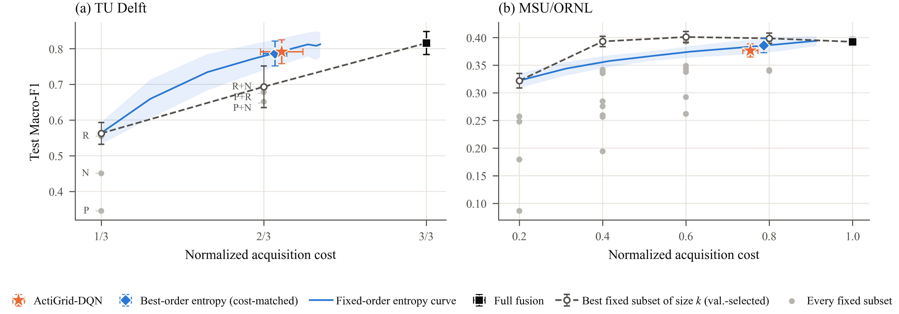

# ActiGrid

**Comparing fixed and sequential evidence selection for cyber–physical power-system diagnosis.**

ActiGrid treats power-system fault-versus-attack diagnosis as a sequential decision. A mask-aware multimodal fusion classifier can classify from any subset of evidence sources. A Double-DQN policy decides which source to acquire next, or stops once the evidence is sufficient. The agent never controls grid equipment: it only chooses which diagnostic evidence to look at.

The paper compares this learned policy against strong simple alternatives (every fixed subset of sources, and every fixed acquisition order with entropy stopping) while sharing **one trained fusion backbone per seed across all policies**. The result is deliberately mixed: sequential acquisition helps on TU Delft, but a tuned fixed-order entropy rule is as good as the DQN, and on MSU/ORNL a compact fixed subset is better than the DQN.

This repository contains the code, the full result files, and the trained seed-42 models behind the paper:

> *ActiGrid: Comparing Fixed and Sequential Evidence Selection for Power-System Diagnosis*, submitted to IEEE PES General Meeting 2027.

## Main results (10 seeds, shared backbone, group-disjoint test split)

| Dataset | Method | Macro-F1 | Normalized cost |
|---|---|---|---|
| TU Delft | Full fusion | 0.8158 ± 0.0323 | 1.000 |
| TU Delft | **ActiGrid-DQN** | **0.7917 ± 0.0333** | **0.703** |
| TU Delft | Best-order entropy stopping | 0.7868 ± 0.0347 | 0.690 |
| TU Delft | Best fixed subset, k = 2 | 0.6933 ± 0.0583 | 0.667 |
| MSU/ORNL | Full fusion | 0.3924 ± 0.0077 | 1.000 |
| MSU/ORNL | ActiGrid-DQN | 0.3769 ± 0.0118 | 0.755 |
| MSU/ORNL | Best-order entropy stopping | 0.3859 ± 0.0131 | 0.787 |
| MSU/ORNL | Best fixed subset, k = 2 | 0.3931 ± 0.0093 | 0.400 |
| MSU/ORNL | **Best fixed subset, k = 3** | **0.4011 ± 0.0101** | **0.600** |

On TU Delft, ActiGrid-DQN keeps 97.0% of full-fusion Macro-F1 while acquiring 29.7% fewer modality units, and beats the best fixed two-source subset by 0.098 Macro-F1. However, the paired difference from the cost-matched fixed-order entropy policy is only +0.005 (95% CI [−0.004, 0.014], Wilcoxon p = 0.43). On MSU/ORNL, the best three-source fixed subset beats the DQN by 0.024 Macro-F1 at lower cost. Cost is the fraction of available modality units acquired (equal cost per modality), not bytes, latency or energy. Paired tests for all comparators are in [`results/controlled_same_backbone/`](results/controlled_same_backbone/).

<p align="center"></p>

## Repository layout

```
actigrid/controlled.py             Final same-backbone experiment (paper Tables I-II, Figs. 2-3)
actigrid/pipeline.py               Data loading, splits, fusion model, DQN, v7 protocol, evaluation
actigrid/reviewer_clearance.py     Fixed-subset and fixed-order entropy helpers and analyses
run_actigrid.py                    Command-line entry point (--stage controlled | v7 | reviewer)
configs/paper_v7.json              Configuration used for the paper
scripts/extract_controlled_results.py  Parses the controlled-run log into CSV
scripts/make_paper_tables.py       Rebuilds the numbers in paper Tables I-II
scripts/make_paper_figures.py      Rebuilds paper Figs. 1-3
results/controlled_same_backbone/  Final same-backbone ten-seed summary and paired effects (paper Tables I-II)
results/reviewer_clearance/        Per-seed exhaustive subsets, order+entropy search, budget curves
results/logs/                      Full run logs (controlled run, v7 run) and the TU Delft file manifest
results/models/                    Seed-42 fusion classifier and DQN policy weights from the v7 run (PyTorch)
results/*_v7_selection.json        Frozen validation selections (lambda, DQN validation cost) used by the final run
results/*.csv                      Earlier v7 protocol outputs (classical baselines, audits)
figures/                           Generated figures
```

## Installation

Python 3.10 or newer is required. The paper results were produced with Python 3.13, PyTorch 2.11, NumPy 2.1 and pandas 2.3. The v7 run used a CUDA GPU; the controlled same-backbone run used CPU.

```bash
git clone https://github.com/sazidul0/ActiGrid.git
cd ActiGrid
pip install -r requirements.txt
```

A GPU is recommended for the full protocol. The code also runs on CPU, but much more slowly.

## Data

Neither dataset is redistributed here. Download both from their original sources.

**MSU/ORNL power-system attack dataset.** This is the multiclass release with 15 `dataN Sampled Scenarios.csv.arff` files. It is available from the [UAH ICS data sets page](https://www.sites.google.com/a/uah.edu/tommy-morris-uah/ics-data-sets). Please cite Pan *et al.*, IEEE TII 2015.

**TU Delft cyber–physical digital-substation dataset.** This dataset is described in N. Cibin *et al.*, "Cyber–physical power system dataset for cyber security of digital substations," *IEEE Access*, vol. 14, 2026, [doi:10.1109/ACCESS.2026.3699153](https://doi.org/10.1109/ACCESS.2026.3699153). Follow the data-availability statement in that paper. Extract the archive before running; the pipeline can call `7z`/`unrar` if it finds only an archive.

A suggested layout:

```
data/
  msu_ornl/        data1 Sampled Scenarios.csv.arff ... data15 Sampled Scenarios.csv.arff
  tudelft_cpps/    2026_03_17_CPPS_Dataset_CyberSec_DigitalSubstation_TUD/...
```

## Reproducing the paper

**1. Rebuild the paper tables and figures from the released results.** This needs no data and no GPU (only `matplotlib` and `numpy`):

```bash
python scripts/extract_controlled_results.py   # log -> results/controlled_same_backbone/*.csv
python scripts/make_paper_tables.py            # Tables I-II and the numbers quoted in the text
python scripts/make_paper_figures.py           # figures/fig_framework, fig_tradeoff, fig_paired_effects
```

**2. Re-run the final same-backbone experiment** (paper Tables I-II and Figs. 2-3). For each dataset and seed, this trains one fusion backbone and evaluates full fusion, all fixed subsets, all fixed orders with entropy stopping and the DQN on it. The frozen selections (λ = 0.5 and the DQN validation costs) are read from `results/*_v7_selection.json`:

```bash
python run_actigrid.py --stage controlled --config configs/paper_v7.json \
    --msu-root data/msu_ornl --tudelft-root data/tudelft_cpps --work-dir outputs
```

Results are written to `outputs/controlled_same_backbone/`: per-seed and summary tables, paired effects, all subsets, order+entropy selections and budget curves, per-class metrics, DQN confusion counts and acquisition paths, and split/class-support manifests. The paper run took about 7 hours on CPU for both datasets; its full log is [`results/logs/controlled_same_backbone.log`](results/logs/controlled_same_backbone.log).

**3. Optional earlier stages.** `--stage v7` re-runs the λ sweep and the earlier ten-seed v7 evaluation that produced the frozen selections. `--stage reviewer` re-runs the fixed-subset and order+entropy analyses on their own (results in `results/reviewer_clearance/`). Neither is needed to reproduce the paper's tables.

**4. Quick smoke test.** This runs the controlled stage with few epochs and episodes and two seeds. The numbers are not meaningful; it only checks that the pipeline runs:

```bash
python run_actigrid.py --config configs/paper_v7.json --quick \
    --tudelft-root data/tudelft_cpps --datasets tudelft --work-dir outputs_smoke
```

Useful options are `--datasets msu tudelft`, `--seeds 42 123`, `--device cpu` and `--data-root data` (which auto-discovers the dataset folders).

## Protocol summary

- **Splits.** MSU/ORNL is split by source file (9/3/3 files; 47,471/15,272/15,634 samples) and TU Delft by recording run (47/16/16 runs; 3,246/1,276/1,316 one-second windows), so no file or run appears in two splits. All five or six classes occur in every split. The ten seeds share one fixed split; uncertainty across seeds reflects stochastic training, not independent test populations.
- **Modalities and cost.** MSU/ORNL has four PMU/relay groups plus cyber logs (cost 0.2 each). TU Delft has physical RSCAD measurements, resource-monitoring features and PCAP network features (cost 1/3 each).
- **Shared backbone.** For each dataset and seed, one fusion classifier is trained with modality dropout and then frozen and shared by full fusion, every fixed subset, the order+entropy policies and the DQN.
- **Policy.** The policy is a Double DQN with class-balanced episodes (20,000 per seed). Its reward is a clipped log-probability gain for the true class minus λ × cost, with ±2 at termination and an extra −1 for confusing a fault with an attack. The true label is used only to compute the training reward; it is never part of the policy state. λ = 0.5 was selected on validation data in the v7 sweep and frozen.
- **Baselines.** These are full fusion; every nonempty fixed subset, with the best subset of each size k selected on validation Macro-F1; and all M! fixed acquisition orders with entropy stopping. For the order+entropy policy, the order and threshold with the best validation Macro-F1 are selected among candidates whose validation cost is within ±0.02 of the DQN's validation cost.
- **Statistics.** Paired DQN-minus-comparator differences with 95% t intervals and exploratory two-sided Wilcoxon signed-rank p-values over the ten seeds.

## Notes on this release

`actigrid/pipeline.py` is the code that produced the v7 results (originally run as a Kaggle notebook). For the release, only the following changed:

- Paths and the configuration can now be set from the command line (`setup()` / `run_actigrid.py`).
- Code that ran at import time was moved into `setup()`.
- A missing `Counter` import in dataset auto-discovery was added. The paper run used explicit dataset paths and never reached that code path.

`actigrid/reviewer_clearance.py` and `actigrid/controlled.py` are the reviewer-clearance and final same-backbone sections of the same script, moved into their own modules. They read `CFG`/`WORK`/`LOG` from `actigrid.pipeline` at call time and take the frozen v7 results folder as an argument instead of searching `/kaggle`. If the selection files are missing, `controlled.py` falls back to built-in, full-precision copies of the frozen selections. Their experimental logic is unchanged.

The model, reward, split and evaluation logic are unchanged. The fixed-subset and entropy results in `results/reviewer_clearance/` come from the same per-seed backbones as the controlled run; `scripts/make_paper_figures.py` checks that the two agree. The DQN comparisons inside `results/reviewer_clearance/` (`*_reviewer_new_baselines_vs_dqn.csv`, `reviewer_holm_corrected_tests.csv`) refer to the earlier v7 DQN; the paper reports the controlled-run DQN in `results/controlled_same_backbone/`. Open-set evaluation, ablations and the EMS stress test remain in the code but are switched off and are not part of the paper's claims.

## Citation

If you use this code, please cite the paper (citation details will be updated after publication):

```bibtex
@inproceedings{actigrid2027,
  title     = {ActiGrid: Comparing Fixed and Sequential Evidence Selection for Power-System Diagnosis},
  author    = {<Authors>},
  booktitle = {Proc. IEEE PES General Meeting},
  year      = {2027}
}
```

## License

The code is released under the MIT License (see [LICENSE](LICENSE)). The datasets are subject to their own licenses and terms of use.
